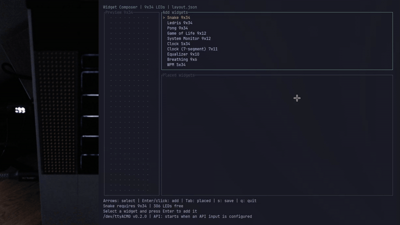

<h1 align="center">Glance</h1>

<p align="center">
  
</p>

<p align="center">
  <a href="LICENSE"></a>
  <a href="https://github.com/iltumio/glance/actions/workflows/desktop.yml"></a>
</p>

Glance composes widgets on a Framework Laptop 16 LED Matrix. Preview the 9×34
output in a terminal editor, position widgets without overlap, save JSON layouts,
and play them on a device with or without the TUI.

The catalog includes Snake, Ledris, Pong, Game of Life, clocks (including a compact
seven-segment clock), computer CPU/RAM statistics, equalizer, breathing, WPM and
configurable progress bars. Progress bars consume values from periodically read
files with JSON Pointer/regex masks, or from one shared Axum JSON-RPC server.



## Getting started

Install Rust 1.95 or newer, [just](https://github.com/casey/just), and your system's
serial dependencies (`libudev-dev` on Ubuntu; `libudev` and `pkg-config` on Arch).
This workspace builds directly for your computer's native target.

### Install on Linux or macOS

The installer builds from source and installs `inputmodule-tui` and
`inputmodule-control` into `~/.local/bin`. Rust and the dependencies above must
already be installed; macOS also needs the Xcode Command Line Tools.

```sh
curl -fsSL https://raw.githubusercontent.com/iltumio/glance/main/install.sh | bash
inputmodule-tui --no-device
```

From a local checkout, run `./install.sh`. Choose another installation prefix with
`./install.sh --prefix /path/to/prefix`; executables go into its `bin` directory.
The installer prints a PATH command if that directory is not already on your PATH.

### Run from a checkout

```sh
just demo
just tui --serial-dev /dev/ttyACM0
just devices
just demo --template inputmodule-tui/templates/progress.json
just template inputmodule-tui/templates/progress.json --serial-dev /dev/ttyACM0
```

The editor needs a terminal of at least 64×24. Enter adds/positions a widget,
Tab switches lists, `e` configures a placed progress bar, `s` saves, and `q` exits.
The [complete guide](inputmodule-tui/README.md) covers keyboard/mouse controls,
template validation, file inputs, JSON-RPC methods and reconnection behavior.

Plain Cargo also works:

```sh
cargo run -- --no-device
cargo build --locked --workspace
cargo test --locked --workspace
```

The `inputmodule-control` binary provides the original hardware control commands:

```sh
just control --help
```

## Linux device permissions

The original udev rules are included in `release/50-framework-inputmodule.rules`.
Install them once, then reconnect the module:

```sh
sudo install -m 0644 release/50-framework-inputmodule.rules /etc/udev/rules.d/
sudo udevadm control --reload-rules
```

## Workspace

| Crate | Responsibility |
| --- | --- |
| `inputmodule-tui` | Widget editor, rendering, JSON templates, inputs, JSON-RPC server and device connection |
| `inputmodule-control` | Hardware control CLI |
| `inputmodule-host` | Shared protocol constants/encoding, monochrome grid and fonts |

## Verification

```sh
just check
just smoke
```

`check` runs formatting, Clippy and tests for all three crates. The four Linux
smoke suites exercise real terminal lifecycle, editor configuration/save/load,
file polling, the HTTP JSON-RPC endpoint, simulated serial output, signal shutdown
and reconnects. CI runs desktop checks on Linux, Windows and macOS, with integration
checks on Linux. The [Build workflow](https://github.com/iltumio/glance/actions/workflows/desktop.yml)
runs on every push and pull request, and can also be started manually. Each run
provides downloadable release binaries for Linux, Windows and macOS.

## Acknowledgements

Thanks to Framework and the contributors to
[FrameworkComputer/inputmodule-rs](https://github.com/FrameworkComputer/inputmodule-rs)
for making their Input Module software and firmware available under the
[MIT License](https://github.com/FrameworkComputer/inputmodule-rs/blob/main/LICENSE).
Their work provides the foundation for Glance's device support.

`inputmodule-host` bundles shared code extracted and adapted from that repository,
including protocol constants and encoding, monochrome frames and fonts. We include
it locally because upstream does not provide a dedicated reusable Rust crate for
host applications.

Glance is licensed under the [MIT License](LICENSE). The original Framework
copyright notice is retained.
